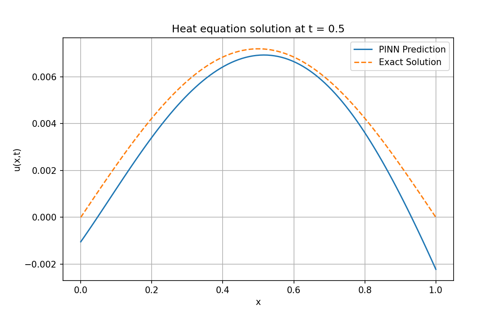

# Physics-Informed Neural Network for the 1D Heat Equation (PyTorch)

Solves u_t = u_xx on x, t in [0, 1] with a PINN, using no labelled solution data.

## Problem
- PDE: u_t = u_xx
- Initial condition: u(x, 0) = sin(pi x)
- Boundary conditions: u(0, t) = u(1, t) = 0
- Exact solution (for validation): u(x, t) = exp(-pi^2 t) sin(pi x)

## Approach
- Network: fully connected, 2 -> 32 -> 32 -> 1, tanh activations
- PDE residual computed with autograd (u_t and u_xx)
- Loss = PDE residual + initial condition + boundary condition (MSE)
- 1,000 collocation points, 100 IC points, 100 BC points per side
- Adam, lr = 0.001, 5,000 epochs

## Results
| Metric | Value |
|---|---|
| Relative L2 error | 1.51e-2 |
| Max absolute error | 1.04e-2 |
| Final training loss | 1.42e-4 |

Error is measured on a 101 x 101 grid over the whole domain against the exact solution.

## Run it
pip install torch numpy matplotlib
python heat_pinn.py

## Limitations
- Small network and fixed collocation points
- Single PDE with known exact solution
- Next: Burgers equation, adaptive collocation point sampling

## Author
Prit Ghoghari
